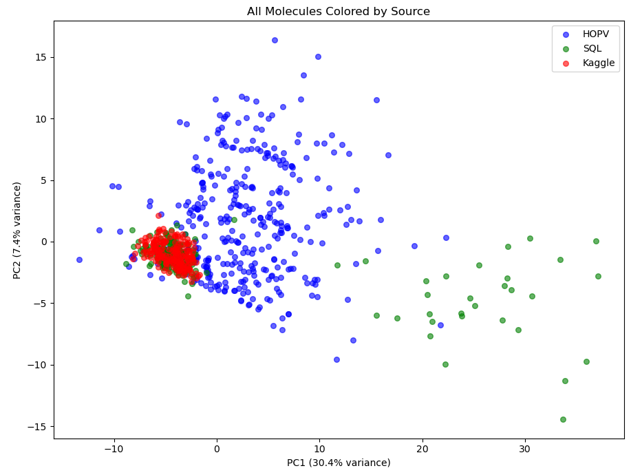

# Molecular Property Prediction for Organic Solar Cells

Designing molecules for organic solar cells normally means running slow quantum-chemistry calculations for every candidate. This project predicts three of those properties directly from a molecule's SMILES string (its stability class and its HOMO and LUMO energy levels) using 217 RDKit chemical descriptors and tree-based models, so thousands of candidates can be screened in seconds. It was built for two Kaggle competitions run within the course.

> Breda University of Applied Sciences, Data Science & AI (year 1) project.



*Principal components of the descriptor space: the competition test molecules (red) sit in a tight region shared with the course database molecules (green) and only partly with the public HOPV set (blue), which is why combining both training sources helped.*

## Results

Cross-validated performance, computed by the training notebooks (5-fold CV on the 534 / 444 labelled molecules from HOPV plus the course database):

| Task | Model | Metric | 5-fold CV |
|---|---|---|---|
| Stability (low / medium / high) | ExtraTrees, 1000 trees, balanced class weights | F1 macro | **0.882** (± 0.063, 2 std) |
| HOMO energy | ExtraTrees | MAE | **0.132 eV** (± 0.020) |
| LUMO energy | ExtraTrees | MAE | **0.200 eV** (± 0.026) |

The submitted energy-level model blends ExtraTrees (80%) with an average of five MLP networks trained with different seeds (20%).

**Kaggle private leaderboard:** from the final competition submission (see report), not reproducible from this repo without the course data.

| Competition | Score | Rank |
|---|---|---|
| [Molecular stability prediction](https://www.kaggle.com/competitions/molecular-stability-prediction-y1b-2025261/leaderboard) | F1 macro 0.83 (includes the leaderboard-informed adjustment below) | 19th |
| [Energy level prediction](https://www.kaggle.com/competitions/energy-level-prediction-y1b-2025261/leaderboard) | MAE 0.112 eV (blended model) | 25th |

Both scores fell short of the targets set in the project brief (F1 ≥ 0.90, MAE < 0.10 eV). The main bottleneck was the "low" stability class: only about 21% of the training molecules, and the class the model struggles to recognise.

### Competition note

The final Kaggle stability submission used leaderboard feedback to set the number of "low" predictions. From the public leaderboard it was inferred that the test set contains about 34 "low" molecules, so the 34 molecules with the lowest predicted probability of being "high" were labelled "low". This is a competition-specific adjustment, not part of the model: with plain model predictions, the classifier labels none of the 200 test molecules "low". In this repo the inference notebook makes plain model predictions by default; the adjustment sits behind an explicit flag (`USE_LEADERBOARD_LOW_COUNT`) with a comment explaining it.

## Approach

1. **Data understanding:** parse the HOPV-15 file (one block of lines per molecule) into a table and explore HOMO/LUMO, missing values and device metadata.
2. **Features:** compute all 217 RDKit descriptors from each SMILES. Then drop constant columns, impute missing values with the median and standardise.
3. **Clustering (exploratory):** K-means and PCA on the descriptors, to see how the training sources relate to the test molecules. The final models don't use the clusters.
4. **Stability classification:** ExtraTrees with balanced class weights, evaluated with stratified 5-fold CV on F1 macro.
5. **HOMO/LUMO regression:** separate ExtraTrees models per target, blended with multi-seed MLPs.
6. **Inference:** the saved preprocessing and models are applied to new SMILES strings.

## Repository structure

```
├── notebooks/
│   ├── 01_hopv_data_understanding.ipynb   parse HOPV, EDA, descriptor table
│   ├── 02_clustering_exploration.ipynb    how training and test molecules relate (exploratory)
│   ├── 03_stability_training.ipynb        stability classifier + CV
│   ├── 04_stability_inference.ipynb       predictions (competition adjustment behind a flag)
│   ├── 05_energy_level_training.ipynb     HOMO/LUMO models + CV
│   └── 06_energy_level_inference.ipynb    predictions
├── src/            data loading and HOPV parser, RDKit descriptors, stability label logic
├── scripts/        download_hopv.py
├── tests/          pytest suite
├── results/        figures
├── models/         trained models are saved here (not committed)
└── data/           empty; see data/README.md
```

## Data

- **Public:** the HOPV-15 dataset (CC BY 4.0) is downloaded by `scripts/download_hopv.py`.
- **Course-only:** the stability labels, the extra course-database molecules and the Kaggle test sets were provided through the course and aren't included. With HOPV alone, the HOMO/LUMO notebooks run end to end. The stability notebooks need the course labels, and their committed outputs come from the original run.
- Details and HOPV-only numbers are in [data/README.md](data/README.md).

## Tech stack

Python · RDKit · scikit-learn (ExtraTrees, MLP, K-means, PCA) · pandas · NumPy · Matplotlib · Jupyter · pytest

## How to run

```bash
git clone https://github.com/OssoFloris/molecular-property-prediction.git
cd molecular-property-prediction
python -m venv .venv
.venv\Scripts\activate            # Windows  (macOS/Linux: source .venv/bin/activate)
pip install -r requirements.txt

python scripts/download_hopv.py   # public HOPV-15 data (16.6 MB)
jupyter nbconvert --to notebook --execute notebooks/05_energy_level_training.ipynb --output-dir data/processed
pytest
```

Or open the notebooks in Jupyter or VS Code and run them in order. Notebooks 01, 02, 05 and 06 run on public data, each in under a minute.

## My contribution

This was an individual project, so everything here is my own work. I followed a CRISP-DM approach:

- **Data engineering:** I wrote a parser for the raw HOPV-15 file, which stores each molecule as a block of SMILES, InChI, experimental values and 3D conformers rather than as a table. I found that missing values were stored as the string `"nan"`, handled duplicate molecules, and built a descriptor table of all 217 RDKit descriptors. I then pulled 232 extra labelled molecules from the course's PostgreSQL database and combined both sources, growing the stability training set to 534 molecules.
- **Modelling:** for stability classification I compared Random Forest and ExtraTrees. ExtraTrees improved cross-validated F1 macro by about 0.08, and I added balanced class weights for the under-represented "low" class. For HOMO/LUMO I trained separate models per target, because LUMO turned out to be much harder to predict. I then blended ExtraTrees with an average of five MLPs trained with different seeds, which brought the competition MAE down from about 0.13 to 0.112 eV.
- **Analysis:** I used K-means clustering and PCA to compare the training sources with the competition test set. This showed that the test molecules resemble the course-database molecules far more than the public HOPV set.
- **What I learned:**
  - Validation strategy matters as much as the model: for stability, cross-validated F1 (0.88) was clearly more optimistic than the private leaderboard (0.83), because the test molecules differ from much of the training data.
  - Class imbalance, not model choice, was the real limit on stability performance.
  - In hindsight, using public-leaderboard feedback to set the number of "low" predictions was a competition trick rather than modelling. That's why it's off by default in this repo.
